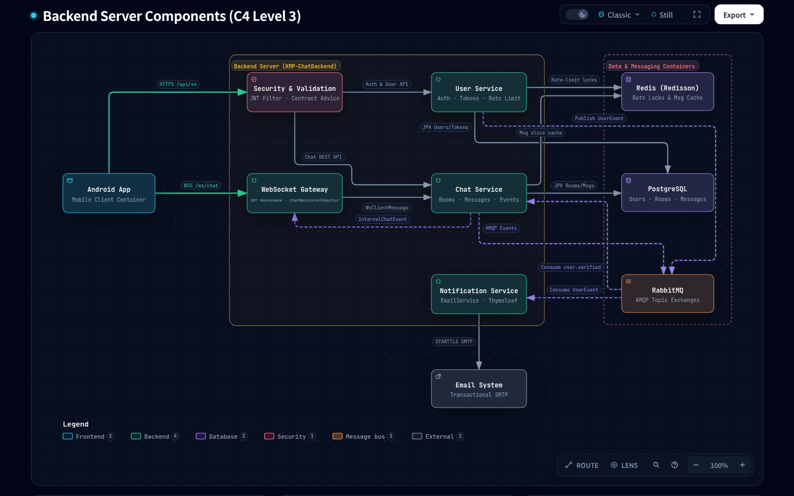

# KMP-ChatBackend Blueprint

## System Overview

Modular monolith backend for the end-to-end chat project — handling stateless JWT authentication, distributed rate
limiting, room/message persistence, real-time WebSocket sessions, and asynchronous domain events.

> **Architecture & Philosophy**
> - Read the [Chat Project Philosophy](../KMP-ChatContract/docs/PHILOSOPHY.md)
>     ([GitHub](https://github.com/neronguyen/KMP-ChatContract/blob/main/docs/PHILOSOPHY.md)) for the architectural
>     principles and AI agent governance rules governing this repository.
> - **Medium
>     Series**: [Part 1 — End-to-End Type Safety: Sharing Pure Kotlin Contracts Between Android and Spring Boot](https://medium.com/@neronguyen/end-to-end-type-safety-sharing-pure-kotlin-contracts-between-android-and-spring-boot-part-1-8c45e3ab6720)

### Related Repositories

| Repository | Role | C4 Architecture Level | Tech Stack |
|:---|:---|:---|:---|
| **[KMP-ChatContract](https://github.com/neronguyen/KMP-ChatContract)** | Compile-time wire schema, error contracts, and shared validators | **Level 1** (System Context) & **Level 2** (Containers) | Pure Kotlin 2.4, `kotlinx.serialization`, `kotlinx-datetime` |
| **[KMP-ChatBackend](https://github.com/neronguyen/KMP-NeroChatBackend)** *(this repo)* | Modular monolith REST & WebSocket server | **Level 3** (Backend Components) | Kotlin, Spring Boot 4, PostgreSQL, Redis (Redisson), RabbitMQ |
| **[Android-ChatApp](https://github.com/neronguyen/Android-NeroChatApp)** | Native Android client with offline-first persistence and real-time sync | **Level 3** (Android Components) | Jetpack Compose, Navigation 3, Retrofit, OkHttp, Room, DataStore, Hilt, Arrow |

### Backend Component Architecture (C4 Level 3)

> **Interactive Architecture Viewers**:
> - **Level 3 — Backend Server Components (Local HTML)**: [`docs/architecture/interactive/c4-backend-components.html`](docs/architecture/interactive/c4-backend-components.html)
> - **Level 1 & Level 2 — System Context & Containers**: [`KMP-ChatContract/docs/architecture/`](https://github.com/neronguyen/KMP-ChatContract/tree/main/docs/architecture)

<picture>
  <source media="(prefers-color-scheme: dark)" srcset="docs/architecture/assets/BackendComponents.png">
  <source media="(prefers-color-scheme: light)" srcset="docs/architecture/assets/BackendComponents.light.png">
  
</picture>

## Subdirectories & System Boundaries

- [app](./app/README.md) - Application bootstrap, Spring Security filter chain, Redis configuration, and OpenAPI tooling.
- [common](./common/README.md) - Domain primitives, JWT token services, global exception handling, and RabbitMQ events.
- [user](./user/README.md) - User authentication, refresh token rotation, email verification, and rate limiting.
- [chat](./chat/README.md) - Chat rooms, messages, `/ws/chat` WebSocket handler, and Redis slice caching.
- [notification](./notification/README.md) - Asynchronous SMTP email delivery triggered by RabbitMQ domain events.
- [build-logic](./build-logic/README.md) - Convention plugin standardizing Kotlin 21 toolchains and dependencies.
- [docs/architecture/flows](./docs/architecture/flows/README.md) - Backend-specific sequence and dataflow specifications.
- [docs/designs](./docs/designs/SITEMAP.md) - Design document index.

## Global Invariants

- **Domain Module Isolation**: Peer domain modules (`:user`, `:chat`, `:notification`) must never depend on or import each other. Cross-module communication is asynchronous via RabbitMQ domain events (`UserEvent`, `ChatEvent`).
- **Service Layer Purity**: Service classes return domain entities/models and throw domain exceptions (never Spring Web `ResponseStatusException`). Mappings to wire DTOs occur at the `@RestController` layer.
- **Contract SSOT**: Wire models and error codes derive strictly from `io.github.neronguyenvn.nerochat.contract.*`.
- **Anti-Enumeration Invariant**: `POST /api/auth/resend-verification` and `POST /api/auth/forgot-password` return `204 No Content` and never return domain `AuthServerError` codes to prevent user enumeration.
- **WebSocket Protocol**: `/ws/chat` sessions use raw Spring `TextWebSocketHandler` with `kotlinx.serialization` text frames (`classDiscriminator = "type"`) and `ConcurrentWebSocketSessionDecorator`.

## Global Side Effects

- **PostgreSQL Database**: Relational tables for accounts (`users`, `refresh_tokens`, `auth_tokens`) and conversations (`chat_rooms`, `chat_participants`, `chat_messages`).
- **Redis (Redisson)**: Distributed locks, IP/email rate limiting buckets, and 30-minute recent message slice cache.
- **RabbitMQ**: AMQP topic exchanges (`chat.events`, `user.events`) for asynchronous choreography.
- **SMTP Server**: Outbound transactional emails for registration verification and password reset.

## System Verification

```bash
# Fast cached verification (Tier 1 - Inner loop)
./scripts/verify.sh fast

# Full clean verification gate (Tier 2 - Pre-commit)
./scripts/verify.sh clean

# Direct Gradle commands
GRADLE_RO_DEP_CACHE=${HOME}/.gradle/caches ./gradlew check --gradle-user-home=/tmp/gradle-ro-home
```
